# Supervision d'un poste Linux avec Zabbix : détection et diagnostic de pannes

Suite de mon projet [Lab réseau virtuel : routeur MikroTik et client Alpine Linux](https://yves-guidebe.github.io/lab-mikrotik-alpine).
J'ajoute un serveur **Zabbix 7.0** au LAN du lab pour superviser le poste client Alpine, provoquer des pannes, puis les diagnostiquer et les corriger.

---

## 1. Objectif

Montrer le cycle de base de la surveillance d'un réseau :

**détecter** (alerte Zabbix) → **diagnostiquer** (ping, `ip a`) → **corriger** → **vérifier** (retour à la normale).

## 2. Environnement

Lab sous **VMware Workstation**, réseau `192.168.20.0/24` (LAN du routeur MikroTik).

| Machine | Rôle | Adresse IP |
|---|---|---|
| Routeur MikroTik (RouterOS) | Passerelle, serveur DHCP `dhcp-lan` | `192.168.20.2` |
| Alpine Linux (`client`) | **Équipement supervisé** | `192.168.20.97` (bail réservé) |
| Zabbix Appliance 7.0.31 | Serveur de supervision | `192.168.20.100` (DHCP) |
| Kali Linux | Poste d'administration (navigateur web) | `192.168.20.98` (DHCP) |

## 3. Mise en place

1. Import de l'appliance Zabbix (format `.vmx`) dans VMware, carte réseau placée sur le LAN du lab.
2. Obtention d'une adresse sur le LAN auprès du DHCP du routeur.
3. Accès à l'interface web depuis le poste Kali ; vérification sur le tableau de bord que le serveur fonctionne (version 7.0.31).
4. Création de l'hôte supervisé dans **Data collection > Hosts** :

| Paramètre | Valeur |
|---|---|
| Nom | `ALPINE-CLIENT` |
| Adresse | `192.168.20.97` |
| Modèle | **ICMP Ping** |
| Groupe | `LAB` |

Le modèle **ICMP Ping** envoie des pings depuis le serveur Zabbix et mesure trois valeurs : **réponse (Up/Down)**, **perte de paquets** et **temps de réponse**. Aucun agent n'est installé sur Alpine : la supervision repose uniquement sur l'ICMP.

L'alerte utilisée est celle du modèle : **« ICMP Ping: Unavailable by ICMP ping »** (gravité *High*).

## 4. État normal

Valeurs relevées pour `ALPINE-CLIENT` (Monitoring > Latest data) :

| Mesure | Valeur |
|---|---|
| ICMP ping | **Up (1)** |
| ICMP loss | **0 %** |
| ICMP response time | **2,15 ms** |

Contrôle manuel depuis la console Zabbix : `ping 192.168.20.97` → 8 paquets envoyés, 8 reçus, **0 % de perte**.

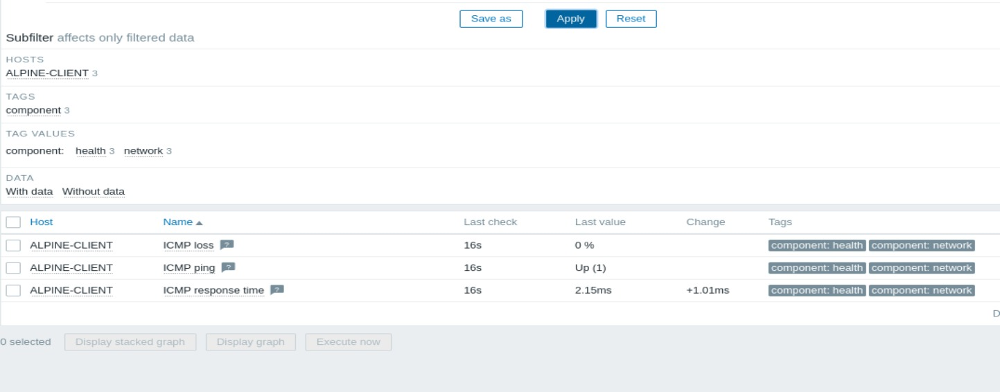
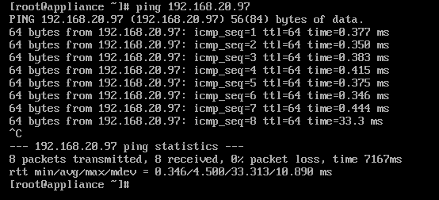

## 5. Scénarios de panne

Les deux pannes ont été **provoquées volontairement** en désactivant l'interface `eth0` d'Alpine. Détail dans [`journal-des-pannes.md`](journal-des-pannes.md).

### Panne 1 : durée 13 min, résolue

| Étape | Constat |
|---|---|
| Détection | Alerte « Unavailable by ICMP ping », début **10:17:31 UTC** |
| Diagnostic | `ip a` sur Alpine : `eth0` à l'état **DOWN**, sans adresse IPv4 |
| Correction | `ip link set eth0 up` puis `udhcpc -i eth0` |
| Résultat | Adresse `192.168.20.97` obtenue (bail de 1800 s) ; alerte **RESOLVED** à **10:30:31 UTC** |

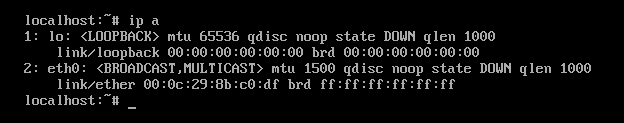
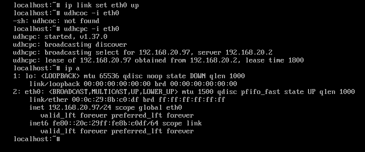
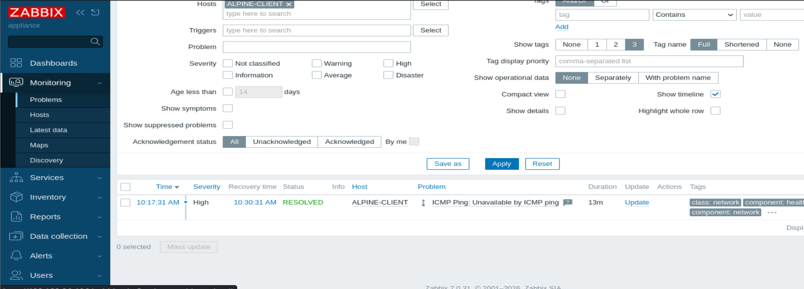

### Panne 2 : adresse IP différente de celle supervisée

| Étape | Constat |
|---|---|
| Détection | Alerte « Unavailable by ICMP ping », début **10:43:31 UTC** |
| Diagnostic | `ping 192.168.20.97` depuis Zabbix : 10 paquets envoyés, **0 reçu**, **100 % de perte**, message *Destination Host Unreachable* |
| Constat | Après la remise en marche, Alpine a reçu **`192.168.20.99`** au lieu de `192.168.20.97` : Zabbix continuait de tester l'ancienne adresse |
| Correction | Sur le routeur, **réservation de `192.168.20.97`** pour l'adresse MAC d'Alpine (bail fixe, sans drapeau `D`) ; sur Alpine, `ip addr flush dev eth0` puis `udhcpc -i eth0` |
| Résultat | Bail de `192.168.20.97` obtenu depuis `192.168.20.2` ; `ICMP ping` de nouveau à **Up (1)**, 0 % de perte |

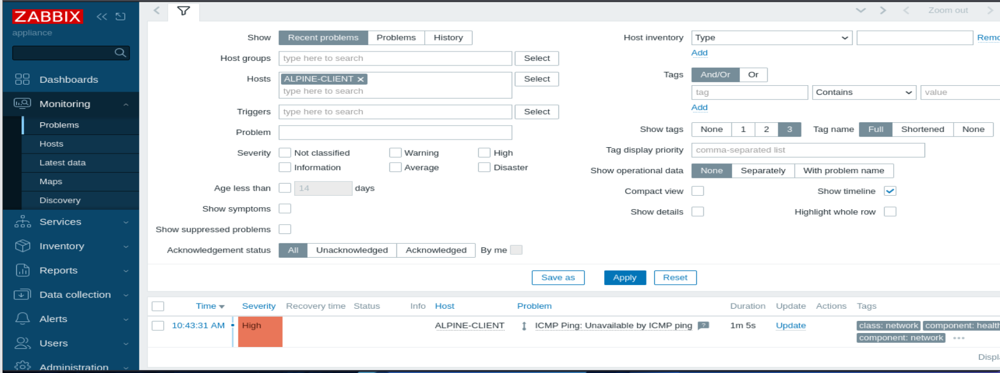
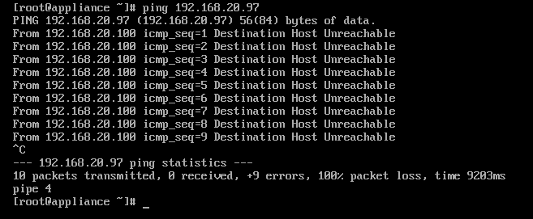
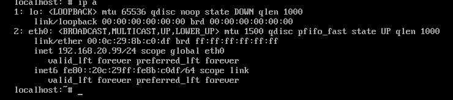
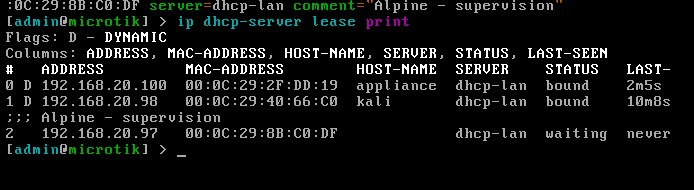
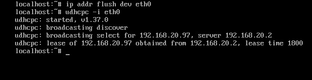

## 6. Autres constats

- **Alpine tourne en mode live** : `df -h /` indique un système de fichiers `tmpfs`. Le système vit en mémoire, donc sa configuration réseau est perdue à chaque redémarrage.
- **Les baux DHCP dynamiques font varier les adresses** (bail de 30 minutes). C'est ce que la panne 2 a montré ; seule l'adresse d'Alpine est réservée à ce stade.

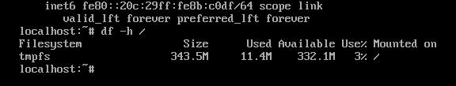
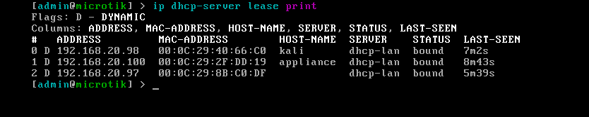

## 7. Limites et pistes d'amélioration

- Un seul équipement est supervisé ; **le routeur MikroTik n'est pas encore intégré** à la supervision.
- Réserver aussi les adresses du serveur Zabbix et du poste Kali.
- Installer Alpine sur disque (`setup-disk`) pour que sa configuration réseau persiste.
- Installer l'agent Zabbix sur Alpine pour suivre le processeur, la mémoire et le disque.
- Superviser le routeur par SNMP (modèle `MikroTik by SNMP`).
- Ajouter une notification par e-mail.

## 8. Ce que j'ai appris

- Installer Zabbix, créer un hôte, lui associer un modèle et lire les mesures et les alertes.
- Remonter à la cause d'une panne avec une méthode simple : `ping`, `ip a`, état de l'interface.
- Un bail DHCP dynamique peut faire changer l'adresse d'une machine supervisée ; une réservation règle le problème.
- Relever l'heure des alertes avec leur fuseau (Zabbix affiche ici l'heure UTC ; le Cameroun est à UTC+1).

## Contenu du dépôt

- `README.md` : ce document
- `journal-des-pannes.md` : chronologie, diagnostic et correction de chaque panne
- `commandes.md` : commandes utilisées
- `01-…` à `12-…` (images `.png`) : captures d'écran du lab

## Auteur

**Guidebe Djopsou Yves Martial** · Douala
Portfolio : [yves-guidebe.github.io](https://yves-guidebe.github.io) · GitHub : [github.com/yves-guidebe](https://github.com/yves-guidebe)
